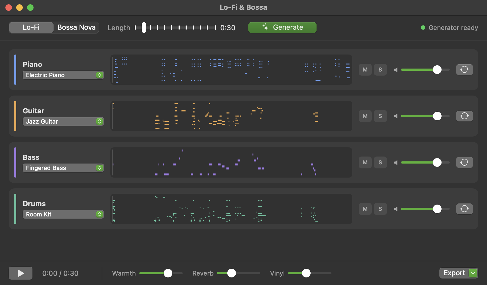
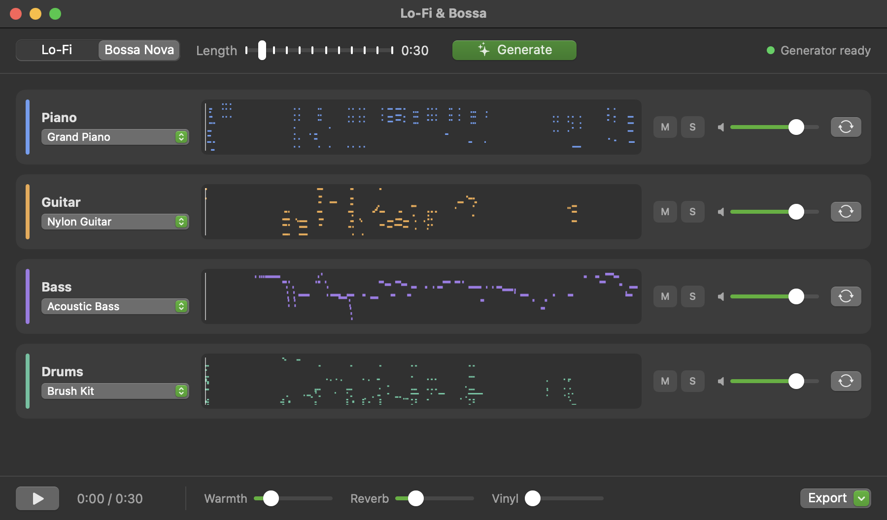

# Lo-Fi & Bossa

A macOS app that writes background music for vlogs. It generates a four-track song
(piano, guitar, bass, drums) with a symbolic music model running locally, and lets you
mix each track, swap its instrument, or have the model rewrite just that one part.



> **Status: working prototype.** Generation, per-track regeneration, mixing, effects and
> export all work end to end. The model is still the general-purpose pretrained checkpoint:
> it has **not** been fine-tuned on lo-fi or bossa nova yet, so the two styles currently differ
> only in sound design (instruments and effects), not in the notes. See [Roadmap](#roadmap).

## What it does

- **Generate** a 15–180 second song in a chosen style.
- **Regenerate one track**: the model writes a new part for that instrument that fits the
  other three, which come back note-for-note unchanged. One level of undo.
- **Mix**: mute, solo and volume per track; pick the instrument sound per track.
- **Style sound design**: Lo-Fi loads electric piano, a room kit, a low-pass filter, reverb and
  vinyl hiss and crackle. Bossa Nova loads grand piano, nylon guitar, acoustic bass and a
  brush kit with the filter open.
- **Export** the mix to WAV or M4A (rendered offline, faster than real time), or the notes to MIDI.

| Bossa Nova sound | Before the first song |
|---|---|
|  |  |

## How it works

```
┌──────────────── macOS app (Swift) ────────────────┐        ┌────── Python (local) ──────┐
│ SwiftUI mixer ── AppState ── API client ──────────┼─ HTTP ─┤ FastAPI server             │
│                     │                             │  JSON  │   └ cached sampler         │
│              AVAudioEngine                        │        │       └ Anticipatory Music │
│  4 samplers → mix → low-pass → reverb → output    │        │         Transformer (128M) │
│                        vinyl noise ───────┘       │        └────────────────────────────┘
└───────────────────────────────────────────────────┘
```

- **Model.** [Anticipatory Music Transformer](https://arxiv.org/abs/2306.08620)
  (`stanford-crfm/music-small-800k`, Apache 2.0). It models notes, not audio, and can write
  around notes that are held fixed, which is what makes single-track regeneration possible.
- **Sampler** (`training/sampler.py`). A replacement for the library's sampling loop with
  key/value caching, an instrument whitelist, a notes-per-second cap, and a retry that stops
  the model from answering with a silent track.
- **Audio.** The app plays the notes itself through `AVAudioEngine` using the General MIDI
  sound bank that ships with macOS, so nothing has to be downloaded for sound.

Measured on an M1 Pro (16 GB): a 30 s song generates in about 13 s, and regenerating one
track takes 3–4 s.

## Run it

Requirements: macOS 14+, Xcode command line tools (Swift 5.10+), Python 3.10–3.13.
The first generation downloads the model weights (about 500 MB) from Hugging Face.

1. Install the Python side:

```bash
python3 -m venv .venv && .venv/bin/pip install -r training/requirements.txt
```

2. Start the generator and leave it running:

```bash
.venv/bin/python training/server.py
```

3. In another terminal, start the app:

```bash
cd app && swift run
```

The dot in the top-right corner turns green when the app can reach the generator.
`⌘G` generates, `Space` plays and pauses, clicking a track's note overview seeks.

### In Xcode

Open `app/LofiBossa.xcodeproj` and press Run (`⌘R`). This builds a regular `LofiBossa.app`
bundle. The project picks up every file under `app/Sources/LofiBossa/` automatically, so new
Swift files added to that folder need no project changes. The generator still has to be
running (step 2).

`app/Package.swift` builds the same sources from the command line (`swift run`).

### Server API

The server can be used without the app:

```bash
curl -o song.mid -H 'Content-Type: application/json' -d '{"style":"bossa","seconds":30}' localhost:8765/generate
```

```bash
curl -o song2.mid --data-binary @song.mid "localhost:8765/regenerate_track?track=bass&style=bossa"
```

Add `"format": "json"` (or send JSON to `/regenerate_track`) to get notes as JSON instead of a
MIDI file. A style uses `checkpoints/<style>/` if that folder exists, otherwise the pretrained model.

## Training data

There is no ready-made dataset for either style, and no public collection labels them:
**GigaMIDI has zero files tagged bossa nova or lo-fi** among its 2.1 million, and MidiCaps has
none either. The training set is therefore assembled like this:

- **Bossa nova** is found in [GigaMIDI](https://huggingface.co/datasets/Metacreation/GigaMIDI)
  by artist (Jobim, João Gilberto, Bonfá, Baden Powell and others) and by standard song titles
  (Desafinado, Corcovado, Garota de Ipanema and so on). A wider tier adds other Brazilian
  popular music, sambas and files labelled latin.
- **Lo-fi** has no direct source. It is approximated by hip-hop and downtempo files at
  55–105 BPM, with jazz, R&B, soul and funk at the same tempos as the wider tier. Much of
  what makes lo-fi sound like lo-fi is production, which the app's sound design covers.
- [GuitarSet](https://zenodo.org/records/3371780) adds real bossa nova guitar comping and
  [Groove MIDI](https://magenta.tensorflow.org/datasets/groove) adds human-played drums.

Every file is reduced to the four tracks. What that produced:

| Style | Tier | Files | Hours |
|---|---|---|---|
| Bossa nova | core | 304 | 9.3 |
| Bossa nova | wide | 1,937 | 39.6 |
| Lo-fi | core | 554 | 30.7 |
| Lo-fi | wide | 1,975 | 107.6 |

665 of the bossa-side files and 900 of the lo-fi-side files have all four tracks; the rest
have one to three (solo piano or guitar arrangements, drum takes) and are still used.

| Dataset | License |
|---|---|
| GigaMIDI | CC BY-NC 4.0, access on request |
| GuitarSet | CC BY 4.0 |
| Groove MIDI | CC BY 4.0 |

### Build the training set

Download GigaMIDI's `Final_GigaMIDI_V1.1_Final` folder into `data/` and log in to Hugging
Face (`hf auth login`) with an account that has access. Then:

```bash
.venv/bin/python training/data/gigamidi_meta.py
```

```bash
.venv/bin/python training/data/download.py groove guitarset
```

```bash
.venv/bin/python training/data/build_manifest.py
```

```bash
.venv/bin/python training/data/gigamidi_extract.py
```

```bash
.venv/bin/python training/preprocess.py
```

The result is `processed/` (clean four-track MIDI, an index and `report.md`). Style rules
are in `training/data/styles.py`.

## Fine-tuning

Fine-tuning is meant for a CUDA GPU. Copy the repository and the `processed/` folder to
the GPU machine, install the requirements, and run one job per style:

```bash
.venv/bin/python training/finetune.py --style bossa --batch-size 16
```

```bash
.venv/bin/python training/finetune.py --style lofi --batch-size 16
```

With the default settings the bossa set is 47,249 training sequences of 1,024 tokens and the
lo-fi set is 105,628 (about 2,950 and 6,600 steps per epoch at batch size 16).

Each run builds its training sequences once (cached in `processed/sequences/`), reports the
validation loss before training, and saves the checkpoint with the lowest validation loss to
`checkpoints/<style>/`. Copy that folder back next to the server and it is used automatically
for that style. `checkpoints/<style>/training_log.json` records the losses.

Each file is used several times: once plain, and several times with a random subset of its
tracks held fixed while the model learns to write the others. That second form is what
per-track regeneration relies on.

Useful options: `--tiers core` trains on the core tier only, `--epochs`, `--lr`,
`--save-last` (also keep the final weights), and `--limit-files 40 --max-steps 30
--batch-size 2` for a two-minute check on a Mac.

**Not yet run at full scale.** The loop has only been checked on a Mac with 23–50 files,
where training loss fell but validation loss did not improve. Whether fine-tuning gives an
audible change in style is still to be shown.

## Repository layout

```
training/
  data/            download, style rules, manifest builder
  preprocess.py    collapse any MIDI to piano / guitar / bass / drums
  sequences.py     training sequences from the preprocessed files
  finetune.py      fine-tune one checkpoint per style
  tracks.py        track definitions, model events <-> MIDI
  sampler.py       cached, instrument-restricted sampling
  server.py        local HTTP API used by the app
  check_model.py   smoke test for the pretrained checkpoint
app/
  Sources/LofiBossa/
    Model/         Song, styles, API client
    Audio/         AVAudioEngine graph, vinyl noise, export
    Views/         generate bar, track rows, transport and effects
```

## Known limitations

- **Not fine-tuned.** Notes come from a general pretrained model; output quality varies a lot
  from seed to seed and does not yet sound specifically like either style.
- **No tempo or key control.** The model works in absolute time, so there is no bar grid.
- **No dynamics.** The model has no note velocity; each track plays at a fixed loudness.
- **The generator is a separate process** that you start yourself.
- Regenerating a track on an extremely dense song can still come back nearly empty.

## Roadmap

1. Run the fine-tuning on a GPU and compare each style against the pretrained model by ear.
2. Piano-roll note editing.
3. Tempo-aware generation and a bar grid.
4. Run the model inside the app (Core ML or MLX) so no Python process is needed.
5. Optional audio model for texture.

## Licensing notes

The pretrained model is Apache 2.0. Several candidate datasets are non-commercial
(GigaMIDI is CC BY-NC), so a model fine-tuned on them is for personal, non-commercial use.
This repository has no license file yet.
