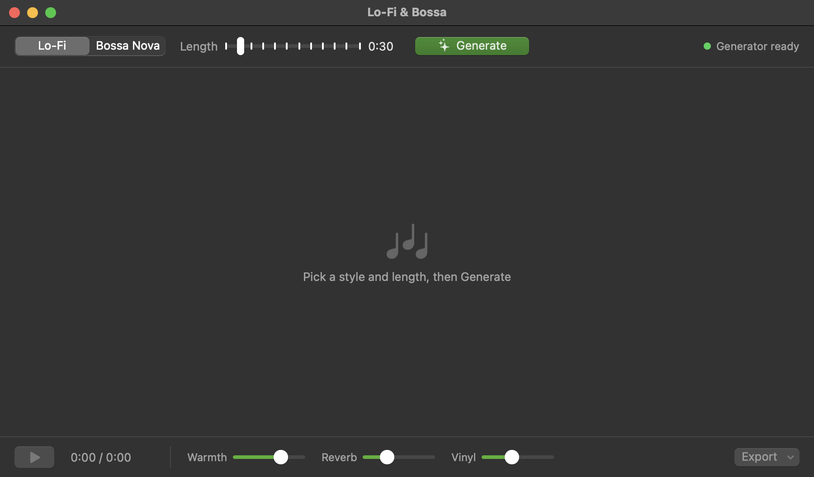

# Lo-Fi & Bossa

A macOS app that writes background music for vlogs. It generates a four-track song
(piano, guitar, bass, drums) with a symbolic music model running locally, and lets you
mix each track, swap its instrument, or have the model rewrite just that one part.


> **Status: working prototype.** Generation, per-track regeneration, mixing, effects and
> export all work end to end. The model is still the general-purpose pretrained checkpoint:
> it has **not** been fine-tuned on lo-fi or bossa nova yet, so the two styles currently differ
> only in sound design (instruments and effects), not in the notes. See [Roadmap](#roadmap).

## What it does

- **Generate** a 15–180 second song in a chosen style.
- **Regenerate one track**: the model writes a new part for that instrument that fits the
  other three, which come back note-for-note unchanged. One level of undo.
- **Mix**: mute, solo and volume per track; pick the instrument sound per track.
- **Style sound design**: Lo-Fi loads electric piano, a room kit, a low-pass filter, reverb and
  vinyl hiss and crackle. Bossa Nova loads grand piano, nylon guitar, acoustic bass and a
  brush kit with the filter open.
- **Export** the mix to WAV or M4A (rendered offline, faster than real time), or the notes to MIDI.

| Bossa Nova sound | Before the first song |
|---|---|
|  |  |

## How it works

```
┌──────────────── macOS app (Swift) ────────────────┐        ┌────── Python (local) ──────┐
│ SwiftUI mixer ── AppState ── API client ──────────┼─ HTTP ─┤ FastAPI server             │
│                     │                             │  JSON  │   └ cached sampler         │
│              AVAudioEngine                        │        │       └ Anticipatory Music │
│  4 samplers → mix → low-pass → reverb → output    │        │         Transformer (128M) │
│                        vinyl noise ───────┘       │        └────────────────────────────┘
└───────────────────────────────────────────────────┘
```

- **Model.** [Anticipatory Music Transformer](https://arxiv.org/abs/2306.08620)
  (`stanford-crfm/music-small-800k`, Apache 2.0). It models notes, not audio, and can write
  around notes that are held fixed, which is what makes single-track regeneration possible.
- **Sampler** (`training/sampler.py`). A replacement for the library's sampling loop with
  key/value caching, an instrument whitelist, a notes-per-second cap, and a retry that stops
  the model from answering with a silent track.
- **Audio.** The app plays the notes itself through `AVAudioEngine` using the General MIDI
  sound bank that ships with macOS, so nothing has to be downloaded for sound.

Measured on an M1 Pro (16 GB): a 30 s song generates in about 13 s, and regenerating one
track takes 3–4 s.

## Run it

Requirements: macOS 14+, Xcode command line tools (Swift 5.10+), Python 3.10–3.13.
The first generation downloads the model weights (about 500 MB) from Hugging Face.

1. Install the Python side:

```bash
python3 -m venv .venv && .venv/bin/pip install -r training/requirements.txt
```

2. Start the generator and leave it running:

```bash
.venv/bin/python training/server.py
```

3. In another terminal, start the app:

```bash
cd app && swift run
```

The dot in the top-right corner turns green when the app can reach the generator.
`⌘G` generates, `Space` plays and pauses, clicking a track's note overview seeks.

You can also open `app/Package.swift` in Xcode and run from there.

### Server API

The server can be used without the app:

```bash
curl -o song.mid -H 'Content-Type: application/json' -d '{"style":"bossa","seconds":30}' localhost:8765/generate
```

```bash
curl -o song2.mid --data-binary @song.mid "localhost:8765/regenerate_track?track=bass&style=bossa"
```

Add `"format": "json"` (or send JSON to `/regenerate_track`) to get notes as JSON instead of a
MIDI file. A style uses `checkpoints/<style>/` if that folder exists, otherwise the pretrained model.

## Training data

There is no ready-made multitrack dataset for lo-fi or bossa nova. The training set has to be
assembled by filtering general MIDI collections and adding small style-specific sets.

| Dataset | What it offers | License |
|---|---|---|
| [GigaMIDI](https://huggingface.co/datasets/Metacreation/GigaMIDI) | Large multitrack collection with style labels; the main candidate | CC BY-NC 4.0, access on request |
| [MidiCaps](https://huggingface.co/datasets/amaai-lab/MidiCaps) | 168k captioned multitrack files; only useful as a "jazz / latin" wide tier | CC BY 4.0 |
| [GuitarSet](https://zenodo.org/records/3371780) | Real bossa nova guitar comping (guitar only) | CC BY 4.0 |
| [Groove MIDI](https://magenta.tensorflow.org/datasets/groove) | Human-played drums, including bossa and hip-hop takes (drums only) | CC BY 4.0 |
| [Lo-Fi Hip Hop MIDIs](https://www.kaggle.com/datasets/zakarii/lofi-hip-hop-midi) | Small lo-fi set, mostly melodies | see Kaggle page |

What the pipeline found so far ("core" = tagged as the style, "wide" = neighbouring genres):

| Source | Bossa core | Bossa wide | Lo-fi core | Lo-fi wide |
|---|---|---|---|---|
| GuitarSet | 72 | 72 | 0 | 72 |
| Groove MIDI | 2 | 46 | 35 | 78 |
| MidiCaps (metadata scan) | 0 | 4,594 | 2 | 780 |

MidiCaps has no bossa nova tag at all and almost no hip-hop or chillout (8 and 17 files out of
168,385), so real multitrack examples of either style still have to come from GigaMIDI.

Run the pipeline:

```bash
.venv/bin/python training/data/download.py groove guitarset
```

```bash
.venv/bin/python training/data/build_manifest.py --midicaps-meta https://huggingface.co/datasets/amaai-lab/MidiCaps/resolve/main/train.json
```

```bash
.venv/bin/python training/preprocess.py
```

This writes clean four-track MIDI to `processed/midi/<style>/` and a summary to
`processed/report.md`. Style rules are in `training/data/styles.py`.

## Repository layout

```
training/
  data/            download, style rules, manifest builder
  preprocess.py    collapse any MIDI to piano / guitar / bass / drums
  tracks.py        track definitions, model events <-> MIDI
  sampler.py       cached, instrument-restricted sampling
  server.py        local HTTP API used by the app
  check_model.py   smoke test for the pretrained checkpoint
app/
  Sources/LofiBossa/
    Model/         Song, styles, API client
    Audio/         AVAudioEngine graph, vinyl noise, export
    Views/         generate bar, track rows, transport and effects
```

## Known limitations

- **Not fine-tuned.** Notes come from a general pretrained model; output quality varies a lot
  from seed to seed and does not yet sound specifically like either style.
- **No tempo or key control.** The model works in absolute time, so there is no bar grid.
- **No dynamics.** The model has no note velocity; each track plays at a fixed loudness.
- **The generator is a separate process** that you start yourself.
- Regenerating a track on an extremely dense song can still come back nearly empty.

## Roadmap

1. Build the multitrack training set from GigaMIDI and fine-tune one checkpoint per style.
2. Piano-roll note editing.
3. Tempo-aware generation and a bar grid.
4. Run the model inside the app (Core ML or MLX) so no Python process is needed.
5. Optional audio model for texture.

## Licensing notes

The pretrained model is Apache 2.0. Several candidate datasets are non-commercial
(GigaMIDI is CC BY-NC), so a model fine-tuned on them is for personal, non-commercial use.
This repository has no license file yet.
