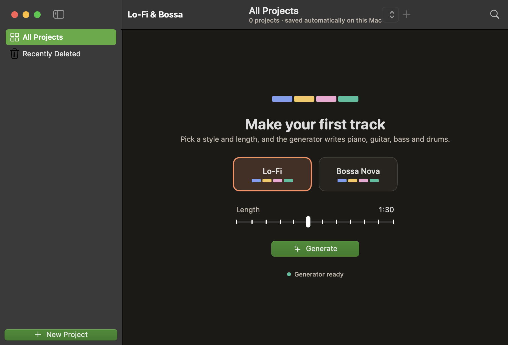
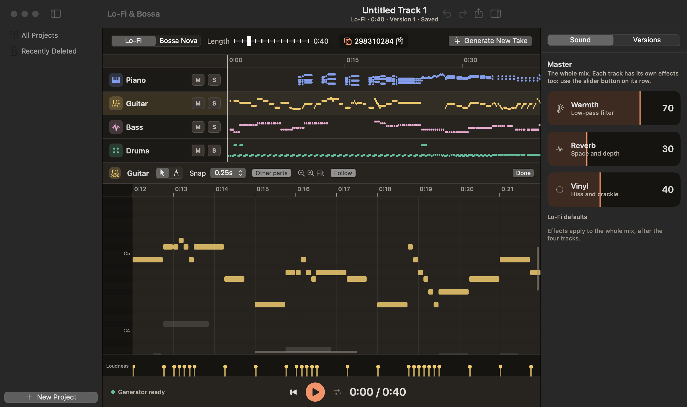
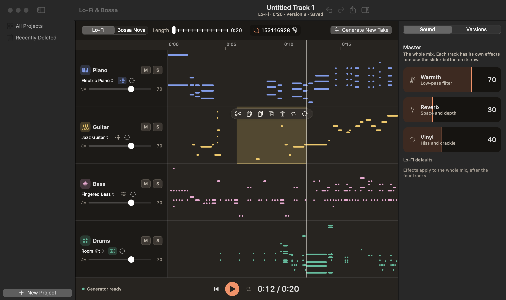
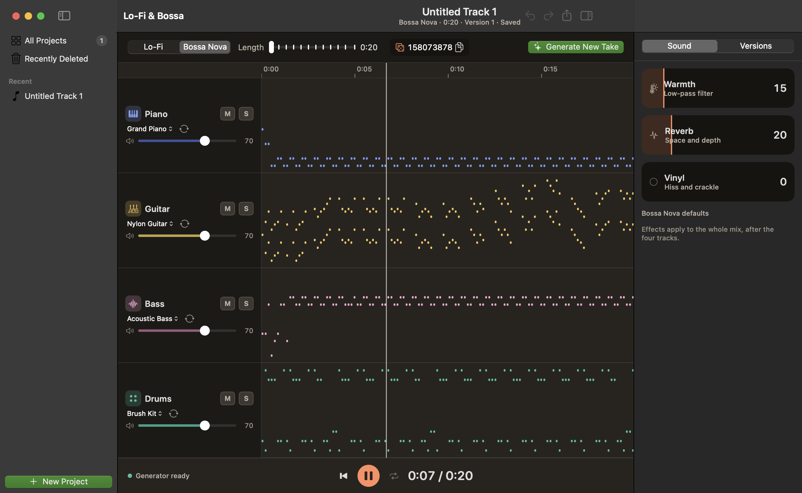
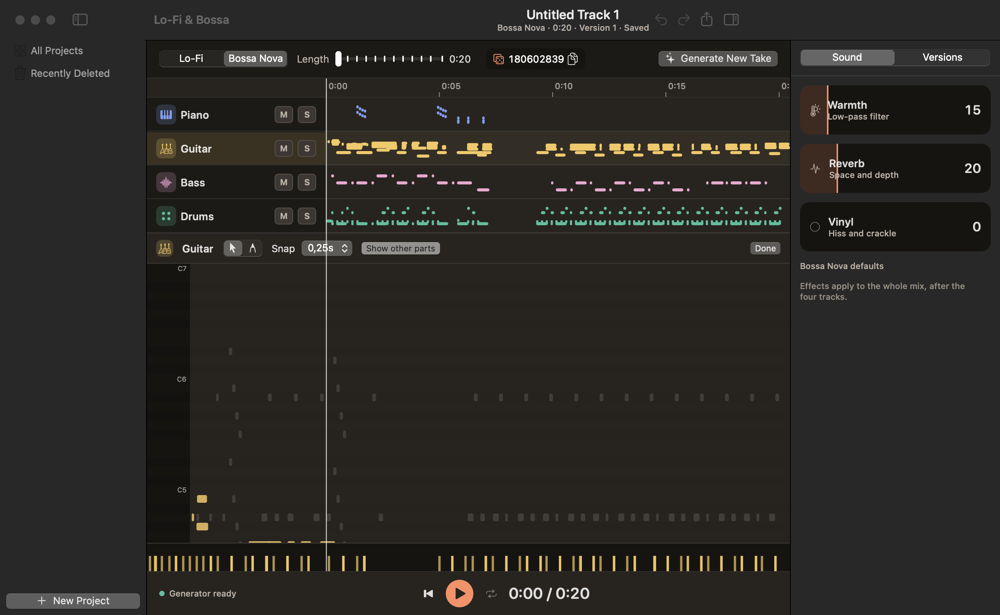

# Lo-Fi & Bossa

An app for Mac, iPad, iPhone and iPhone Duo that writes background music for vlogs. It
generates a four-track song (piano, guitar, bass, drums) with a symbolic music model running
locally, keeps every take as a version you can go back to, and lets you mix each track, swap
its instrument, rewrite just one part, or open a piano roll and edit the notes by hand. Three
optional tracks (Keys & Pads, Lead, Vibes) can be added from the Track menu or the "Add Track"
row; each add or remove is a version, and the four core tracks always stay. You can lock tracks
so the next take is written around them, extend a song from where it ends, and set its key,
note length and busyness. Generating needs the Mac for now: the iPhone and iPad apps play,
mix, edit and export, but can't write new music yet (see [Known limitations](#known-limitations)).



> **Status: working Mac app, iOS layouts built, model fine-tuned.** On the Mac, projects,
> versions, generation, per-track rewriting, the mixer, effects and export all work end to
> end, built to a design produced with Claude Design (the handoff is in `docs/design/`). The
> iPhone, iPad and iPhone Duo layouts are built and run in the Simulator. Both styles have been
> fine-tuned on all seven tracks; the checkpoints aren't in this repository (see
> [Fine-tuning](#fine-tuning)). See [Known limitations](#known-limitations) and
> [Roadmap](#roadmap): next is running the model on the device with Core AI.

## What it does

- **Projects, autosaved.** A library of songs, each saved under
  `~/Library/Application Support/LoFiBossa/`, no Save command needed. Rename, duplicate,
  delete (to Recently Deleted for 30 days, then gone), search.
- **Generate** a 15–180 second song in a chosen style, with a seed field: pin a seed to
  reproduce a take, or leave it on "random" and copy out whichever seed you liked.
- **Versions.** Every generate, rewrite, note-editing session and restore adds a version.
  Listen to an old one from the current playhead position without disturbing the current
  take, star ones worth keeping, and restore one as a new version (nothing is ever lost).
- **Rewrite one track**: the model writes a new part for that instrument that fits the
  other three, which come back unchanged.
- **Edit a section of one instrument**: drag on a track's lane to pick a stretch of time
  (snapped to a quarter second), then cut, copy, paste at the playhead, duplicate, delete, or
  drag the picked stretch to move it. A small pill over the selection, the lane's right-click
  menu and the keyboard (`⌘X ⌘C ⌘V ⌘D`, `⌫`, `Esc`) all do the same things. Pasting replaces
  what was there, a note is never left ringing into a cleared stretch, and each edit is a
  version, so Undo and the Versions tab cover it.
- **Edit notes by hand** in a piano-roll editor: select, draw, move, resize, delete, snap,
  with the other three parts visible as ghost notes for context. It zooms and scrolls in time
  (pinch, `⌘+` / `⌘−` / `⌘0`, or the buttons), has its own ruler (click to seek, drag to loop),
  opens on the part's own pitch range, and can follow the playhead. Notes sound as you click,
  draw or drag them. Drag the stems in the Loudness lane to set how hard each note is played.
  Keys: `V` select, `P` draw, `⌘A`, `⌘C` `⌘X` `⌘V` (pastes at the playhead) `⌘D`, `⌫`, `←` `→`
  nudge by the snap, `↑` `↓` a semitone, `⇧↑` `⇧↓` an octave, `Esc`. Shift-click adds to the
  selection; Option-drag drags a copy.


- **Mix**: mute, solo, volume and instrument per track, plus master Warmth (low-pass),
  Reverb and Vinyl hiss/crackle, each with a style default and a one-click Reset.
- **Effects per track**: the slider button on each track row opens Warmth, Grit (a crunchy
  tape-like texture), Echo, Reverb and Pan for just that instrument. Lo-Fi starts with a
  little grit and warmth on piano and drums, Bossa Nova with a little room on the guitar. They
  are part of exports too.
- **Rewrite just a section** with the model: select a stretch of one instrument and press the
  rewrite button (or right-click, Rewrite Section). Only that stretch is regenerated, written
  around the other three instruments and the same instrument's music before and after it.
  Everything else is untouched, and it is one version you can undo.
- **Loop a range** of the song for preview or for export.
- **Export** to WAV or M4A (rendered offline, faster than real time) or notes-only MIDI,
  for the whole song or just the loop range.
- **The app starts its own generator.** No terminal step: launching the app launches
  `training/server.py` for you (see [How it works](#how-it-works)).



| Working on a song | Piano-roll editor |
|---|---|
|  |  |

## How it works

```
┌────────────────────── macOS app (Swift) ───────────────────────┐   ┌─── Python (local) ──┐
│ SwiftUI (library, stage, piano roll, inspector)                 │   │ FastAPI server       │
│   └ ProjectViewModel ── GeneratorClient ────────────────────────┼─HTTP─ cached sampler     │
│        │                    │                                   │ JSON │  Anticipatory     │
│   ProjectStore         GeneratorProcess ─ launches & supervises ─┼──────│  Music Transformer│
│   (autosave JSON)           │                                   │      │  (128M)           │
│                       AVAudioEngine                              │   └──────────────────────┘
│            4 samplers → mix → low-pass → reverb → output         │
│                        vinyl noise ───────┘                      │
└───────────────────────────────────────────────────────────────┘
```

- **Model.** [Anticipatory Music Transformer](https://arxiv.org/abs/2306.08620)
  (`stanford-crfm/music-small-800k`, Apache 2.0). It models notes, not audio, and can write
  around notes that are held fixed, which is what makes single-track rewriting possible.
- **Sampler** (`training/sampler.py`). A replacement for the library's sampling loop with
  key/value caching, an instrument whitelist, a notes-per-second cap, and a retry that stops
  the model from answering with a silent (or endlessly silent) track.
- **Generator process.** `GeneratorProcess.swift` launches `training/server.py` itself as a
  child process and supervises it (the "Generator offline/starting/ready" pill and the
  "Restart Generator" button), rather than expecting you to start it by hand. Because of how
  it locates the repo (see the comment in that file), this only works run straight from a
  checkout on the machine that built the app — exactly how this project is used.
- **Audio.** The app plays the notes itself through `AVAudioEngine` using the General MIDI
  sound bank that ships with macOS, so nothing has to be downloaded for sound.

Measured on an M1 Pro (16 GB): a 20 s song generates in well under a minute, and rewriting
one track takes a few seconds.

## Run it

Requirements: macOS 14+, Xcode command line tools (Swift 5.10+), Python 3.10–3.13. The
iPhone and iPad app needs iOS 27 and full Xcode.
The first generation downloads the model weights (about 500 MB) from Hugging Face.

1. Install the Python side:

```bash
python3 -m venv .venv && .venv/bin/pip install -r training/requirements.txt
```

2. Start the app — it launches the generator itself:

```bash
cd app && swift run
```

The pill in the bottom-left reads "Generator starting…" for a few seconds, then
"Generator ready". If you'd rather run the generator yourself (for the server API below, or
to watch its log in a terminal), start `.venv/bin/python training/server.py` first; the app
detects it's already running and uses it instead of starting its own.

`⌘↩` generates, `Space` plays and pauses, double-click a track
opens its piano-roll editor, `⌘Z`/`⌘⇧Z` undo and redo, `⌘E` exports.

### In Xcode

Open `app/LofiBossa.xcodeproj` and press Run (`⌘R`). This builds a regular `LofiBossa.app`
bundle, with its own icon. The project picks up every file under `app/Sources/LofiBossa/`
automatically, so new Swift files added to that folder need no project changes.

For iPhone, iPad and iPhone Duo, pick the `LofiBossaiOS` scheme and a simulator. It builds
the same sources; the layout follows the window's size class and the Duo's fold
(`Views/Phone/`, `Views/Pad/`, `Views/Duo/`, chosen in `Views/AdaptiveRootView.swift`).

`app/Package.swift` builds the same sources from the command line (`swift run`, Mac only).

### Dev flags

A few command-line flags, kept for this project's own testing (and handy if you're changing
the app): `--render song.json style out.wav` renders a generator wire-format song to audio
without a window; `--screenshot out.png [delaySeconds]` saves a picture of the window and
quits; `--window WIDTHxHEIGHT` sets an exact frame (bypassing AppKit's restored window size);
`--demo [style] [lengthSeconds]` creates a project and generates, as the UI would, for a
quick end-to-end check; add `--editor` to also open the piano roll once that finishes.
`--data-dir PATH` keeps a run's projects in `PATH` instead of the real library — use it with
`--demo`, which creates projects. `--roll-zoom N [seconds]` (with `--editor`) opens the roll zoomed N times, scrolled to a time. `--sections` (with `--demo`) drives every section operation
through the real app and prints what happened; add `--stress` for forty edits in a row.
`--hit-sweep [delaySeconds]` hit-tests every point of the window and prints where it stops if
SwiftUI's hit testing ever crashes. `--fx piano.warmth=1,drums.grit=0.8` (with `--render`) sets
exactly those per-track effects, `--fx none` renders every track unprocessed, and
`--render-fx-popover out.png` draws the effects popover to an image. `--fake-generator` swaps
the model for an instant, deterministic one (no Python), with `--fake-delay SECONDS` to make it
take time. On iOS, `--layout compact|regular|twoPage|tabletop` forces a layout on any
simulator, and `--local-generator` uses a server already running on the Mac.

Tests: `cd app && swift test` (decoding of projects saved by older versions, among others).

### Server API

The server can be used without the app:

```bash
curl -o song.mid -H 'Content-Type: application/json' -d '{"style":"bossa","seconds":30}' localhost:8765/generate
```

```bash
curl -o song2.mid --data-binary @song.mid "localhost:8765/regenerate_track?track=bass&style=bossa"
```

Add `"format": "json"` (or send JSON to `/regenerate_track`) to get notes as JSON instead of a
MIDI file. `"model"` is `auto` (default: the style's `checkpoints/<style>/` if it exists, otherwise
the pretrained model), `pretrained` or `finetuned`. `/health` lists the styles that have a
fine-tuned checkpoint.

**Busyness.** The model tends to write endless runs of short repeated notes and to stack four or
more notes on most onsets, so the server cleans every result per track before returning it
(`training/tidy.py`): a chord-size cap (piano, keys, guitar 4, vibes 3, bass and lead 1), at most
60% of onsets as full chords, thinned repeats, a minimum gap and a notes-per-second cap, and a
rest carved into parts that never stop. `busyness` sets how hard: 0 sparse, 0.5 default, 1 the
model's notes untouched (`/generate` takes one value or `{track: value}`, `/regenerate_track` a
`busyness` query). Only the model's new notes are cleaned; notes the user wrote in the app are
never limited. In the app it is the Busyness slider next to Length, with a per-track override in
each track's effects popover; it applies to the next take or rewrite.
`.venv/bin/python training/tidy.py --report song.json --busyness 0.5` shows what it would do to a
song (notes per second, chord share, longest phrase, most notes sounding).

**Note length and key.** Two more knobs, independent of busyness and of each other (they still
apply even at busyness 1, the model's raw output). `note_length` (0 short, 0.5 default, 1 long)
nudges new notes toward being longer while sampling, stretches the staccato notes that remain
with `legato()`, and keeps drum hits short; `key` (a name like `"A minor"`, or `"auto"` to detect
it from the song) keeps new, non-drum notes in that key, discouraged by default or forbidden
outright with `strict_key`. `/generate` and `/regenerate_track` take `note_length`, `key` and
`strict_key`, and report the key actually used as `"key"` in the response. In the app: the key
button next to Busyness (shows the detected key when Auto), with Note Length and a per-track
override in each track's effects popover, same shape as Busyness.
`.venv/bin/python training/tidy.py --report song.json --note-length 0.8 --key auto` shows both
on a song.

**Building on the current song.** Lock a track (the lock key next to M and S, or ⌥⌘L) and the
next Generate keeps it exactly as it is and writes the other tracks around it (`/generate` with the
current `song` and a `locked` list). Extend (⇧⌘↩) continues the whole song for 30 more seconds,
up to 3:00, starting from where it ends (`POST /extend` with the `song` and `seconds`); the song's
own notes come back unchanged. Both are versions, so Undo goes back.

## Training data

There is no ready-made dataset for either style, and no public collection labels them:
**GigaMIDI has zero files tagged bossa nova or lo-fi** among its 2.1 million, and MidiCaps has
none either. The training set is therefore assembled like this:

- **Bossa nova** is found in [GigaMIDI](https://huggingface.co/datasets/Metacreation/GigaMIDI)
  by artist (Jobim, João Gilberto, Bonfá, Baden Powell and others) and by standard song titles
  (Desafinado, Corcovado, Garota de Ipanema and so on). A wider tier adds other Brazilian
  popular music, sambas and files labelled latin.
- **Lo-fi** has no direct source. It is approximated by hip-hop and downtempo files at
  55–105 BPM, with jazz, R&B, soul and funk at the same tempos as the wider tier. Much of
  what makes lo-fi sound like lo-fi is production, which the app's sound design covers.
- [GuitarSet](https://zenodo.org/records/3371780) adds real bossa nova guitar comping and
  [Groove MIDI](https://magenta.tensorflow.org/datasets/groove) adds human-played drums.

Every file is reduced to the four tracks. What that produced:

| Style | Tier | Files | Hours |
|---|---|---|---|
| Bossa nova | core | 304 | 9.3 |
| Bossa nova | wide | 1,937 | 39.6 |
| Lo-fi | core | 554 | 30.7 |
| Lo-fi | wide | 1,975 | 107.6 |

665 of the bossa-side files and 900 of the lo-fi-side files have all four tracks; the rest
have one to three (solo piano or guitar arrangements, drum takes) and are still used.

| Dataset | License |
|---|---|
| GigaMIDI | CC BY-NC 4.0, access on request |
| GuitarSet | CC BY 4.0 |
| Groove MIDI | CC BY 4.0 |

### Build the training set

Download GigaMIDI's `Final_GigaMIDI_V1.1_Final` folder into `data/` and log in to Hugging
Face (`hf auth login`) with an account that has access. Then:

```bash
.venv/bin/python training/data/gigamidi_meta.py
```

```bash
.venv/bin/python training/data/download.py groove guitarset
```

```bash
.venv/bin/python training/data/build_manifest.py
```

```bash
.venv/bin/python training/data/gigamidi_extract.py
```

```bash
.venv/bin/python training/preprocess.py
```

The result is `processed/` (clean four-track MIDI, an index and `report.md`). Style rules
are in `training/data/styles.py`.

## Fine-tuning

Preprocessing keeps all seven tracks (keys, lead and vibes as their own instruments; which files
are kept still depends only on the four core tracks), and training uses rare-track boosts
(`--boost-vibes`, `--boost-lead`) and `--transpose`. Each checkpoint records the tracks it knows
in `tracks.json`; the server uses the pretrained model for tracks a checkpoint wasn't trained
on (an older four-track one). Defaults guard against overfitting (low learning rate, weight decay, early stopping, per-track validation loss; `--freeze-layers`/`--dropout` if needed), and `training/blend.py` mixes the result with the base model. Step-by-step cloud instructions: [training/cloud/README.md](training/cloud/README.md).

Fine-tuning is meant for a CUDA GPU. Copy the repository and the `processed/` folder to
the GPU machine, install the requirements, and run one job per style:

```bash
.venv/bin/python training/finetune.py --style bossa --batch-size 16
```

```bash
.venv/bin/python training/finetune.py --style lofi --batch-size 16
```

With the default settings the bossa set is 47,249 training sequences of 1,024 tokens and the
lo-fi set is 105,628 (about 2,950 and 6,600 steps per epoch at batch size 16).

Each run builds its training sequences once (cached in `processed/sequences/`), reports the
validation loss before training, and saves the checkpoint with the lowest validation loss to
`checkpoints/<style>/`. Copy that folder back next to the server and it is used automatically
for that style. `checkpoints/<style>/training_log.json` records the losses.

Each file is used several times: once plain, and several times with a random subset of its
tracks held fixed while the model learns to write the others. That second form is what
per-track regeneration relies on.

Useful options: `--tiers core` trains on the core tier only, `--epochs`, `--lr`,
`--save-last` (also keep the final weights), and `--limit-files 40 --max-steps 30
--batch-size 2` for a two-minute check on a Mac.

**Run at full scale** (one epoch per style, a 24 GB GPU, the defaults above): validation loss
went from 0.919 to 0.891 for bossa and from 0.926 to 0.884 for lo-fi, with every track improving,
and no overfitting (it kept improving to the end). A first run with three epochs and a higher
learning rate overfit, which is what the current defaults guard against. The checkpoints live
in `checkpoints/` and are not in git (they're large, and trained on non-commercial data); a
fresh clone uses the pretrained model until you train or copy them in. How much better they
sound is for your ears; the numbers say the gain is modest.

## Repository layout

```
training/
  data/            download, style rules, manifest builder
  preprocess.py    collapse any MIDI to piano / guitar / bass / drums
  sequences.py     training sequences from the preprocessed files
  finetune.py      fine-tune one checkpoint per style
  tracks.py        track definitions, model events <-> MIDI
  sampler.py       cached, instrument-restricted sampling
  server.py        local HTTP API used by the app
  check_model.py   smoke test for the pretrained checkpoint
app/
  Assets.xcassets/   app icon only (see "Design tokens" below for why colors aren't here)
  Sources/LofiBossa/
    DesignSystem/    colors, spacing, radii, type — see docs/design/tokens.json
    Models/          Project, Version, SongSnapshot, Track, Note, TrackID, MusicStyle
    Services/        API client, GeneratorClient/GeneratorProcess, ProjectStore (autosave)
    ViewModels/      ProjectViewModel: generation, versions, transport, mix, export
    Views/           library, project stage, piano roll, inspector, export sheet
docs/
  design/            tokens.json and the design handoff doc (text only; no binaries)
```

## Design tokens

Colors are defined in Swift (`DesignSystem/Tokens.swift`) as dynamic light/dark values, not
as an Asset Catalog colorset, so the same source compiles under both `swift run` (SwiftPM,
whose plain executables have no reliable path to a compiled asset catalog) and the Xcode
project (a native target, which has no `Bundle.module`). The values themselves are exactly
the ones in `docs/design/tokens.json`. The app icon, which does need a real Asset Catalog,
lives only in `app/Assets.xcassets/` (outside `Sources/LofiBossa/`, so SwiftPM's build
ignores it and only the Xcode build picks it up).

## Keyboard shortcuts

Help ▸ Keyboard Shortcuts (⌘/) lists them all. The menus carry them: Edit (⌘Z / ⇧⌘Z step through
versions and name what they undo), Song, Transport (⌘[ ⌘] nudge the playhead), Track (⌘1–⌘7 pick a
track; ⌥⌘M mute, ⌥⌘S solo, ⌥⌘P piano roll, ⌘R rewrite), View (⌥⌘I inspector). Section and
piano-roll keys work when those have focus.

## Tests

```bash
cd app && swift test                                   # unit tests, ~20 s, no screen needed
xcodebuild -project app/LofiBossa.xcodeproj -scheme LofiBossa test   # unit + UI tests
.venv/bin/python -m unittest discover training/tests  # clean-up, keys, training helpers
```

- **Unit tests** (`app/LofiBossaTests`): note editing, project coding, the audio engine,
  and the view model (generate, versions, undo, listening to a past version, section edits and
  rewrites, piano-roll sessions) against `FakeGeneratorClient` and a temporary project folder.
  Several listen to the real output level while playing, because "it plays but is silent" has
  happened more than once.
- **UI tests** (`app/UITests`, XCUITest): drive the real app launched with `--fake-generator`
  (an instant, deterministic generator, no Python server) and a throwaway `--data-dir`. They take
  over the mouse and keyboard for a minute and need Accessibility permission for Xcode.

## Known limitations

- **iPhone and iPad can't generate yet.** The Python server runs only on the Mac, so the iOS
  apps show "Generator offline" and can play, mix, edit and export songs but not write new
  ones. The model has been converted to Core AI and its output matches PyTorch
  (`training/COREAI_SPIKE.md`), but the in-app engine isn't built and its speed on a real
  device hasn't been measured.
- **Fine-tuned checkpoints aren't in the repository.** A fresh clone uses the general
  pretrained model until you train (`training/cloud/`) or copy the checkpoints in. Even
  fine-tuned, the gain is modest and quality varies a lot from seed to seed.
- **No tempo control, and no dynamics from the model.** The model works in absolute time, so
  there's no tempo or bar grid. Key and note length can be set, but the model never writes a
  loudness: every note gets a fixed per-track velocity. The piano roll's Loudness lane does
  edit it for playback.
- **On iOS every instrument sounds like the default tone.** iOS has no built-in General MIDI
  sound bank, so picking a different instrument doesn't change the sound there.
- **Untested on real hardware.** The iOS layouts were checked in the Simulator only. The
  iPhone Duo's fold detection has never run (no Duo simulator with iOS 27.1 yet; the layouts
  were checked by forcing them), and Apple Pencil, Stage Manager sizes and a hardware keyboard
  on iPad are untested.
- **The Duo's left page uses stand-in views** until the iPhone's track cards and recipe strip
  are swapped in.
- **Songs top out at 3:00**, including with Extend.
- **Undo/Redo is a version pointer, not the system `UndoManager`.** It steps backward and
  forward through the version list rather than integrating with the Edit menu's undo stack.
- **The write-head streaming animation isn't wired up.** The server returns a finished song,
  not a stream, so whole-song generation shows the per-track sweep rather than notes appearing
  as they're written.
- **Drums has no custom SF Symbol**; its track tile draws four small dots instead.
- Rewriting a track on an extremely dense song can still come back nearly empty.

## Roadmap

1. Run the model inside the app with Core AI (port the sampler, tokenizer and clean-up to
   Swift behind the existing `GeneratorClient`), first measuring real speed on a device. This
   is what makes generation work on iPhone and iPad.
2. Swap the iPhone components into the Duo's left page; test on real devices.
3. Sounds on iOS: ship a small sound bank so instruments differ.
4. True zoom/scroll in the Mac piano roll; a proper `UndoManager` integration.
5. Tempo-aware generation and a bar grid; an endless "radio" mode built on Extend.

## Licensing notes

The pretrained model is Apache 2.0. Several candidate datasets are non-commercial
(GigaMIDI is CC BY-NC), so a model fine-tuned on them is for personal, non-commercial use.
This repository has no license file yet.
